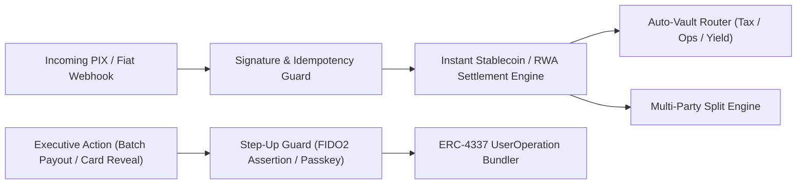

# Non-Custodial Corporate Treasury Architecture (FIDO2/WebAuthn + ERC-4337)

Reference architecture and security patterns from **[New Money Bank](https://newmoneybank.com)** for operating non-custodial corporate accounts combining **ERC-4337 Account Abstraction**, **FIDO2/WebAuthn hardware passkeys**, **programmable split/escrow vaults**, and **instant PIX/stablecoin settlement**.

---

## Architectural Goals

1. **Zero Custodial Key Risk:** Corporate treasuries operate via smart accounts (ERC-4337) controlled by hardware-backed FIDO2/WebAuthn passkeys (`secp256r1` / `P-256` + session step-up verification).
2. **Deterministic Automated Allocation (Auto-Vaults & Splits):** Incoming fiat settlement (PIX) automatically routes into programmable sub-vaults (Tax Reserve, Payroll, Suppliers, Tokenized Gold `PAXG`, and US Treasuries `USDY`) at settlement time.
3. **Defense-in-Depth Step-Up Authorization:** Sensitive operations (batch payouts, virtual card PAN/CVV reveal, collateralized credit drawdowns) enforce cryptographic step-up verification (`X-Step-Up-Auth` / WebAuthn assertion) independent of the ambient session cookie.

---

## High-Level Settlement & Security Flow

---

## Included Reference Module (`step_up_guard.py`)

Demonstrates our production defense-in-depth pattern for:
- Dynamic Multi-Domain Relying Party (`rp_id`) validation for FIDO2/WebAuthn assertions;
- Constant-time Step-Up verification decorator for high-risk treasury routes;
- Automated percentage-based treasury vault partitioning with integer-cent precision (zero floating-point drift).
